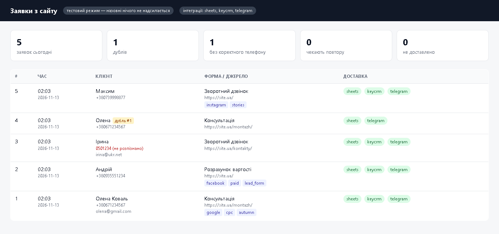

# Автоматизація обробки заявок

Заявка з форми на WordPress за кілька секунд потрапляє в Google-таблицю, CRM і Telegram-чат відділу продажів.



## Ланцюжок

```
WordPress (Contact Form 7 / Elementor)
        │  вебхук
        ▼
  очищення даних ──► дубль? ──► SQLite (журнал)
        │
        ├──► Google Sheets (Apps Script)
        ├──► KeyCRM або Bitrix24: лід + задача "передзвонити"
        └──► Telegram-чат менеджерів
                       ▲
       повтори при збоях (1, 2, 4… хв, до 5 спроб)

  09:00 щодня ──► звіт керівнику на пошту
```

## Що робить сервіс

- **Приймає** вебхуки від Contact Form 7 (form-data) і Elementor (JSON), токен у URL
- **Чистить дані**: телефон до формату `+380XXXXXXXXX` (8067…, 067…, з дужками й дефісами), ім'я з великої літери, email у нижньому регістрі, UTM-мітки з полів форми або з адреси сторінки
- **Ловить дублі**: та сама людина (телефон або email) протягом доби — в CRM другий лід не створюється, у таблиці рядок підсвічується, у Telegram позначка «повторна»
- **Розсилає** в Google Sheets, KeyCRM / Bitrix24 (лід + задача з дедлайном 15 хв) і Telegram
- **Не губить заявки**: кожна доставка — окремий запис у журналі; при збої зовнішнього сервісу — повтор з наростаючою паузою, кнопка «повторити зараз» в адмінці
- **Щоденний звіт** о 09:00: кількість заявок, дублі, джерела за UTM, форми, недоставлені
- **Сторінка `/admin`** (Basic Auth) — журнал заявок і статуси доставки

## Варіант на n8n

Якщо клієнт хоче міняти логіку сам, без програміста — у `n8n/lead-flow.json` є готовий workflow (Webhook → очищення в Code-ноді → Google Sheets + Telegram з повторами). Імпорт: *Workflows → Import from file*.

## Google Sheets

Скрипт `apps-script/Code.gs` вставляється в таблицю і публікується як веб-застосунок. Він дописує рядки під блокуванням (одночасні заявки не перетирають одна одну) і не дублює рядок, якщо сервіс повторив запит.

## Запуск

```bash
python -m venv .venv
.venv/bin/pip install -r requirements.txt
cp .env.example .env     # заповнити ключі
uvicorn leads.main:app --port 8000
```

За замовчуванням `DRY_RUN=true` — інтеграції нічого не надсилають назовні, все видно в `/admin`. Тестові заявки:

```bash
python scripts/send_test_leads.py --url http://127.0.0.1:8000 --token change-me
```

У WordPress (Contact Form 7) вебхук підключається плагіном «CF7 to Webhook» на адресу
`https://your-server/webhook/wordpress?token=...`.

## Тести

```bash
pip install -r requirements-dev.txt
pytest -q
```

## Стек

Python, FastAPI, SQLite, httpx, Google Apps Script, n8n, REST API KeyCRM / Bitrix24, Telegram Bot API.
